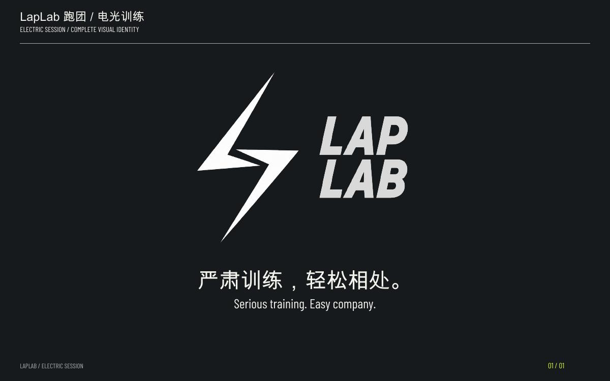

# LapLab Running Club Visual Identity

**严肃训练，轻松相处。**

这是 LapLab 跑团已选定的「电光训练」视觉与内容项目：从完整视觉规范、实体物料和社媒图文，到 Remotion 视频工程、配乐样片、Suno 主题曲及歌词，集中放在一个独立仓库中，便于跑团使用、复盘和持续延展。


> 本项目源码公开，按 **PolyForm Noncommercial 1.0.0 限非商业用途使用**；不是允许自由商用的 MIT 项目。媒体与品牌素材另行保留权利，见下方许可说明。



## 先看什么

1. [完整视觉设计方案 · 18 页 PDF](visual/LapLab-电光训练-完整视觉方案.pdf)：整体视觉和应用一览。
2. [最新双语配乐快闪 · 18 秒 MP4](videos/LapLab-电光训练-双语配乐快闪.mp4)：9:16 小红书竖版，已加入主题曲。
3. [四首主题曲及歌词入口](music/README.md)：保留原始 WAV，不用预览压缩版替代。
4. [完整离线包](https://github.com/joannahe/laplab-running-club-visual-identity/releases/latest)：供直接发给跑团团长。解压后打开 `开始阅读.html`，无需安装软件即可浏览资料、试听和播放视频；浏览器不支持的文件可用本机播放器打开。
5. 想继续设计或交给 Agent：[AGENTS.md](AGENTS.md)、[品牌规范](docs/BRAND.md)、[社媒规范](docs/SOCIAL.md)、[视频延展指南](docs/VIDEO.md)。

## 项目里包含什么

| 目录 | 内容 |
|---|---|
| `visual/` | 电光训练完整视觉 PDF、封面预览 |
| `materials/applications/` | 横幅、背心、跑帽、纹身贴、贴纸、主页背景与主页预览，共 7 张 |
| `materials/social/zh/` | 7 张中文社媒图文 |
| `materials/social/en/` | 7 张独立英文社媒图文 |
| `videos/` | 双语配乐快闪、独立无声片头、独立无声片尾 |
| `public/` | 原始 Logo、11 张实际使用照片、字体及视频素材 |
| `public/music/` | 4 首由项目负责人提供的 Suno 原始 WAV |
| `music/lyrics/` | 中英文创作歌词原稿 |
| `music/prompts/` | 慢跑迷幻电子风格生成提示词，保留英文以便复制使用 |
| `src/` | 可编辑的 Remotion 时间轴、Logo、双语照片叠字与品牌变量 |
| `docs/` | 中文品牌、视频、素材及验收规范 |
| `scripts/` | 素材检查、完整离线打包脚本 |
| `.agents/skills/` | 主题 KV、线下物料、社媒图文、短视频四个 Agent 技能 |
| `templates/` | 可复制的活动设计简报 |

## 为什么这样设计

Lap 代表一圈圈训练与积累，Lab 代表实验、探索和创新。两个交叠的 L 形成原始闪电标识。

颜色只使用电光训练：炭黑 `#171A1D`、粉笔白 `#F3F4ED`、电光绿 `#D7FF3F`、冷灰 `#A8B0AD`。本项目不包含另外两套备选配色。

视频遵循「一次一条信息」：大 Logo 独立出现，口号透明叠在照片上，中文白色、英文小字电光绿，位置避开人脸。中文社媒版保持纯中文，英文社媒独立制作。规范说明使用中文，英文歌词、英文图文、生成提示词及第三方许可证保留原文。

## 不写代码也能用

- 查看 PDF 确认方向；物料为概念展示，正式制作时用原始标识套版并打样确认。
- 直接取 `materials/social/` 中需要的语言版本；不要把中英文版重新堆在同一张图上。
- 用 `videos/` 成片预览投放效果，或把独立片头片尾拼入自己的视频。
- 从 `public/music/` 试听歌曲，结合歌词和提示词继续实验。两套歌词是创作原稿，不是四首音频的逐字转写或同步字幕。

## 用 Agent 设计新的活动主题

项目提供四个场景技能，共用电光训练品牌规范：

| 场景 | 技能 |
|---|---|
| 新主题主视觉／跨场景方向 | [laplab-kv](.agents/skills/laplab-kv/SKILL.md) |
| 横幅、衣服背面、跑帽、贴纸 | [laplab-print](.agents/skills/laplab-print/SKILL.md) |
| 社媒封面、轮播、主页背景 | [laplab-social](.agents/skills/laplab-social/SKILL.md) |
| Remotion 短视频、片头片尾 | [laplab-video](.agents/skills/laplab-video/SKILL.md) |

让 Agent 打开完整仓库，读取相应技能并描述你的活动。例如：

> 读取 `.agents/skills/laplab-social/SKILL.md`，为「夜色里一起刷圈」做三张中文招募图。信息页用浅底大字，使用现有跑团照片；日期地点先标待确认，不出英文版。

支持技能调用的客户端也可使用 `$laplab-social` 等名称；未发现技能时直接指定上述文件路径即可。无需先安装到系统技能目录。

新主题改变文案、照片和构图，默认保留电光训练配色及组合 Logo。跨场景可先用 KV 技能形成 `theme.md` 再复用；单场景可直接开始。详见 [场景工作流与调用示例](docs/CREATIVE-WORKFLOW.md)、[简报模板](templates/creative-brief.md)。

技能是可复用的设计流程。静态物料已有 PNG 参考，需要 Agent 新建可编辑版式；视频有可运行的 Remotion 工程。新结果默认放 `out/<主题>/`，不会自动覆盖已验收物料，也不会自动发布。

## 运行和重新生成视频

需要 Node.js（20.19+、22.13+ 或 24+，以 package.json 为准）及 npm；Remotion 渲染使用 Chrome/Chromium。首次安装依赖和浏览器可能需要网络。完整包里的 PDF、图片、歌曲和成片可直接离线使用，源码复现需要先准备依赖。

```sh
npm ci
npm run assets:check
npm run typecheck
npm run dev
```

Studio 中选择 `LapLab-Xiaohongshu-Flash`。

```sh
npm run render:portrait
npm run render:opening
npm run render:ending
```

默认输出到 `out/`。也可以指定已安装的 Chrome 路径：

```sh
npx remotion render LapLab-Xiaohongshu-Flash out/portrait.mp4 --browser-executable=/path/to/chrome
```

当前样片采用《Serious Training, Easy Company》开头 18 秒，0.3 秒淡入、最后 1.2 秒淡出。更换摘录可设置 `musicStartSeconds`：

```sh
npx remotion render LapLab-Xiaohongshu-Flash out/portrait.mp4 --props='{"musicStartSeconds":30}'
```

`src/PortraitFilm.tsx` 可以调整每个镜头、照片与音乐文件；`src/brand.ts` 管理品牌颜色；`src/LogoScene.tsx` 管理原始组合标。换照片后必须重新检查中英文叠字与人脸位置。

## 可以怎样延展

- 把同一结构用于每周训练回顾、活动招募、长距离跑记录。
- 替换照片和日期内容，保留字号、组合标、语言层级与颜色体系。
- 修改时间轴以适配更长或更短的内容；双语镜头仍需给足阅读时间。
- 选取另一首随附主题曲的段落，并重新处理开头、结尾和响度。
- 通过 Agent 修改：先让它读 AGENTS.md，再读具体规范，最后渲染验收，不能只改源码不看成片。

## 打包完整离线版本

需要 Python 3（仅使用标准库）。

```sh
npm run package:offline
```

输出 `out/LapLab-Running-Club-Visual-Identity-完整离线包.zip`。包中包含本仓库的素材与源码，排除 Git 历史、node_modules、缓存、环境变量和重复输出。文件完整性见 `docs/assets.manifest.json`。

## 许可与商用

- 代码、脚本和配套技术说明：使用 [PolyForm Noncommercial 1.0.0](LICENSE)，允许许可证范围内的非商业使用、修改和分享。商用联系 GitHub 维护者 joannahe（https://github.com/joannahe） 另行取得授权；正式范围以原文为准。
- Logo、照片、歌曲、歌词、视觉方案、生成提示词、设计物料及成片：不纳入代码许可证，保留各自权利，见 [MEDIA-LICENSE.md](MEDIA-LICENSE.md)。
- Barlow 字体按随附 SIL OFL 1.1；其他依赖使用各自许可。

本仓库是源码公开的非商业项目。请保留 NOTICE 和 LICENSE，不把公开可下载理解为可任意商用品牌或媒体素材。

## 维护者

维护者：[Jingke He / joannahe](https://github.com/joannahe)
